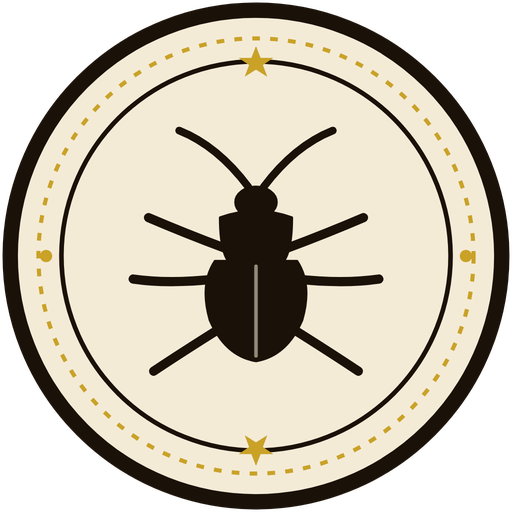

# Cockroach Community

  

Cockroach Community is an offline peer-to-peer (P2P) mesh communication Android application. It enables devices to discover each other, chat, share files, and place voice/video calls completely offline using Wi-Fi Direct, Bluetooth, and local mesh networking.

## Features
- **100% Offline P2P Mesh**: Discover nearby devices without internet access.
- **Secure End-to-End Encryption**: Encrypted messaging and local file transfer.
- **Direct Voice & Video Calling**: Local WebRTC peer-to-peer audio and video calls.
- **Fast File Sharing**: High-speed local peer-to-peer transfers.
- **Modern Jetpack Compose UI**: Clean, responsive Material 3 design system.

## Privacy Policy
Read our [Privacy Policy](https://chaubeyprashant.github.io/cockroach-community/privacy.html) on GitHub Pages.
